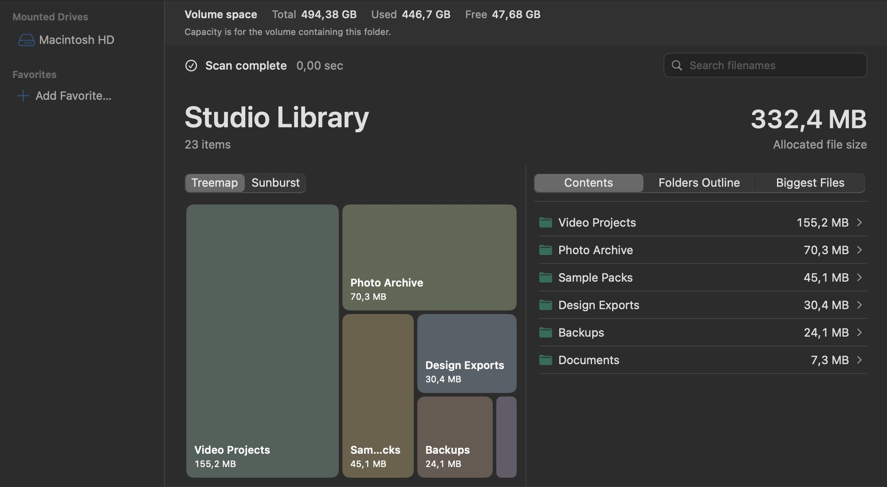
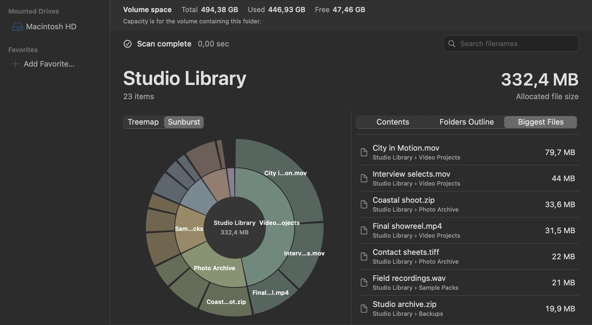

# Space Surfer — Free disk space analyzer for Mac

Find what’s taking up space on your Mac. Space Surfer is a free, open-source disk space analyzer for macOS 14 and later. Scan your startup disk, an external drive, or a single folder, then use an interactive disk map to find the largest files and folders.

**[Download Space Surfer v0.1.0 for macOS](https://github.com/dderugin/space-surfer/releases/download/v0.1.0/Space-Surfer-v0.1.0-macOS.zip)**

Requires macOS 14 or later on Apple silicon or Intel. Unzip the download and move **Space Surfer.app** to **Applications**. This release is ad hoc signed and has no Apple notarization. If Gatekeeper shows a first-launch warning, see [Apple’s guidance on opening downloaded apps](https://support.apple.com/en-us/102445).



*Disk usage for the Studio Library sample folder.*

## What you can do

- **See what’s using your storage.** Browse live disk usage in a treemap or sunburst chart and click into any folder for a closer look.
- **Find your biggest files.** Rank files by allocated size across a folder and its subfolders, or search the entire scan by filename.
- **Review files before freeing up space.** Preview items with Quick Look, reveal them in Finder, or move selected items to Trash.
- **Scan locally.** Space Surfer reads file metadata on your Mac. Favorites and display preferences stay in macOS user defaults.

## Build and run on macOS

You’ll need macOS 14 or later, Apple’s Command Line Tools, Swift 6, and Python 3.

```sh
git clone https://github.com/dderugin/space-surfer.git
cd space-surfer
bash scripts/build-app.sh
open "dist/Space Surfer.app"
```

The build script ad hoc signs the app for local use and verifies the signature. If Space Surfer is already open, relaunch it to load the new build. The script accepts additional `swift build` options such as `-debug-info-format none` when a local environment restricts debug symbol generation.

## Explore a scan

Click **Scan Macintosh HD** to scan the startup drive, **Scan Home Folder** to scan your account’s home directory, or **Scan Folder…** to choose a folder or another mounted drive. The progress banner appears immediately, and the map and file browser update as the scanner discovers items. **Stop Scan** keeps the partial results available. Click a folder tile to focus the map and file browser on that folder. Click the focused folder chip, **All Folders**, or press **Esc** to clear the focus. Use the intermediate breadcrumbs to jump to an ancestor.

Click a drive or favorite in the sidebar to start a scan directly. Use **Add Favorite…** in the sidebar or right-click a folder row or map item and choose **Add to Favorites**. Right-click a favorite to remove its shortcut. The sidebar button or **⌃⌘S** hides or shows the sidebar.

The **Volume space** bar sits above the scan status and search. It shows total, used, and free space for the volume as the scan gets underway. After a whole-volume scan finishes, **Unaccounted** shows how much reported used space exceeds the allocated bytes found by the scan. Snapshots, filesystem metadata, protected files, and other volumes sharing APFS storage can contribute to that difference. Folder scans show their containing volume’s capacity. Stopped scans retain the volume totals alongside their partial results.

Click a file tile to select it and show its path. **Show in Finder** reveals the selection or the focused folder. **Contents** lists immediate children by allocated size. **Folders Outline** shows a folder-only tree with expandable branches. **Biggest Files** ranks individual files throughout the current folder and displays their parent paths. All three views read the same in-memory scan. The map shows up to 36 entries. During scanning, pending sizes can appear with a placeholder tile so folders are clickable as soon as they are discovered. The lists can show more entries on demand.

Switch between **Treemap** and **Sunburst** above the space map. The Sunburst’s inner ring shows the current folder’s largest items, and its outer ring shows children of the largest visible folders. Both views update during a scan. Click a folder sector to open it, or use the arrow in the center of the Sunburst to go up one level.



Use **Search filenames** beside scan status or press **⌘F** to find files and folders anywhere in the current scan. Search matches part of a name, ignores case, and adds matches as the scan discovers them. Click the clear button or press **Esc** to return to the file browser. Select a result and press **Space** to open or close macOS Quick Look. **Quick Look** is also available in the row and map tile context menus.

Command-click files and folders to build a selection. Right-click a selected row or map tile to see **Get Info**, **Move to Trash**, and **Delete Permanently…** for the selection. **Get Info** opens Finder’s standard Info window for each item. macOS may ask for permission to control Finder on first use. The context menu names the item or shows how many selected items the actions apply to. Right-clicking an unselected item opens actions for that item. Removal is available after you finish or stop the scan. Permanent deletion asks for one confirmation and includes the contents of selected folders. Moving items to Trash frees space when the Trash is emptied. The results refresh after removal.

The scanner totals allocated bytes reported for regular files. It counts hard-linked storage once per device and assigns the bytes to one alias. The alias that carries those bytes can vary across scans because workers may discover the links in a different order. The scanner lists symbolic links without following them. Sizes can differ from Finder or volume capacity reports because APFS can share blocks between clones and retain snapshots. Scan threads opt out of File Provider downloads. Items whose metadata or directory contents need a download are reported as skipped, along with unreadable entries and nested mounted volumes. Startup-volume firmlinks are scanned when accessible.

## Tests

Run `swift test` to verify the scanner and app logic. If the Command Line Tools install the Swift Testing macros in a separate directory, add `--disable-xctest -Xswiftc -plugin-path -Xswiftc "$(dirname "$(xcrun --find swiftc)")/../lib/swift/host/plugins/testing"`.

Add `--enable-code-coverage` to instrument the tests. Use `swift test --show-codecov-path` to locate SwiftPM’s JSON report. To inspect the app test target separately with the Swift Build backend, run `xcrun llvm-cov report .build/debug/SpaceSurfTests.xctest/Contents/MacOS/SpaceSurfTests -instr-profile=.build/debug/codecov/default.profdata Sources/SpaceSurf/*.swift`.

The suite exercises bulk and POSIX scans, ranking, removal, the scan session, and treemap geometry. Trash tests substitute a temporary destination for the system Trash. Finder Automation and SwiftUI interaction require a native smoke test.

## Architecture

- **DiskWalker** reads directory metadata in bulk with a POSIX fallback. Up to four workers share a queue of 32 open directories. When the queue is full, workers traverse the next directory locally. Each worker publishes its progress in batches, and all workers share one hard-link table. After cancellation, the scanner joins the workers and closes pending directories before making the partial index available for removal actions. `ScanIndex.c` updates compact records and filename storage in short batches under a write lock. Ranking uses a bounded heap for the requested page. Filename search reads the existing name storage in short batches and resumes from a cursor as directories are indexed. Item IDs and ancestry stay stable for a scan, even when a removed branch has been detached from the index.
- **ScanCore** owns the native handles and provides asynchronous ranking, cancellation, and security-scoped access. `ItemRemoval` checks the scanned identities of the root, ancestor folders, and selected item during preparation and again before changing the filesystem. `RemovalBatch` collapses overlapping selections and reports partial failures. The app refreshes the scan when hard links, a move within the scanned volume, or a partial folder deletion make a local update insufficient.
- **SpaceSurf** uses `ScanSession` to coordinate one active operation. `ScanWindow` presents the app state and dialogs. `ResultsView` owns navigation and selection, while `FolderPanels`, `FolderOutline`, and `SpaceMap` render the results. The browser reuses pages for an unchanged query and refreshes them as live progress advances or a scan completes.

## Benchmark

Run `swift build -c release --product SpaceSurfBench`. Compare `.build/release/SpaceSurfBench bulk /path/to/fixture 1` for serial traversal with `.build/release/SpaceSurfBench bulk /path/to/fixture 4` for four workers. The native modes accept one to four workers and default to four. Use `posix` to benchmark the fallback, or `.build/release/SpaceSurfBench foundation /path/to/fixture` for the Foundation baseline. Each run reports elapsed time, entry count, allocated bytes, skips, and peak resident memory. For equivalent totals, use a readable fixture of ordinary files and folders on one volume.

These historical measurements predate storage of on-disk identities for removal checks. The table compares the original serial scanner with the worker-based scanner on two generated APFS fixtures of 100,000 files each. Each value is the median of five warm, interleaved runs on the development Mac.

| Fixture | Mode | Previous serial | 1 worker | 2 workers | 3 workers | 4 workers |
| --- | --- | ---: | ---: | ---: | ---: | ---: |
| 20 directories | Bulk | 0.189 s | 0.184 s | 0.148 s | 0.144 s | 0.131 s |
| 10,100 directories | Bulk | 0.921 s | 0.898 s | 0.516 s | 0.373 s | 0.336 s |
| 20 directories | POSIX | 0.228 s | 0.216 s | 0.122 s | 0.107 s | 0.091 s |
| 10,100 directories | POSIX | 1.326 s | 1.244 s | 0.694 s | 0.539 s | 0.483 s |

All runs agreed on entry counts, 12,800,000 allocated bytes, and zero skips. Median peak RSS for the original serial and new four-worker builds ranged from 12.7 to 13.6 MiB across the two modes and fixtures.

In an earlier comparison on a generated APFS fixture of 999,000 files and 1,000 directories, the original serial bulk scanner and Foundation both counted 65,536,000 allocated bytes and zero skips. The first measured pass took 2.07 s in bulk mode and 4.90 s in Foundation. Across two warm repeats, the medians were 2.03 s and 4.62 s respectively. Peak process RSS ranged from 25.9 to 26.8 MiB for the bulk scanner, which keeps the live browsing index, and from 7.6 to 7.7 MiB for the Foundation totals-only baseline.

## License

Space Surfer is available under the [MIT License](LICENSE).
